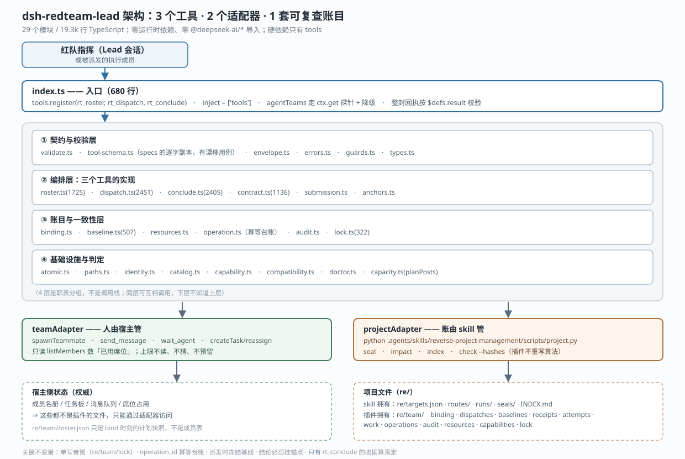

# 架构（dsh-redteam-lead）

> 图：[architecture.svg](architecture.svg)　·　模块职责：[MODULE-MAP.md](MODULE-MAP.md)　·　接缝：[SEAMS.md](SEAMS.md)　·　裁决史：[DECISIONS.md](DECISIONS.md)

一句话：**把「派活 — 干活 — 验收」这段过程，变成宿主机上有契约、有基线、有收据的可复查记录。**

## 1. 它存在的理由：三方各缺一块

| 谁 | 有什么 | 缺什么 |
|---|---|---|
| **DSH Agent Teams**（宿主） | 造成员、发消息、等待/中断、任务板与 owner | 不知道"这一活是在什么约定下派的"，也不管"交回来的东西算不算数" |
| **reverse-project-management**（skill） | 项目账目规则：`INDEX.md`、RUN 目录、`seal`/`impact`/`index`/`check --hashes` | 不管人怎么派；skill 自己写明"编排插件管理成员、任务和交付，**不替代**本 skill 的证据与验收规则" |
| **本插件** | 三者的粘合：契约 + 基线 + 收据 | —— |

所以它**不是**再实现一遍团队协作，而是**叠在 Agent Teams 之上的一层账目**：
`rt_dispatch` 自己就调宿主 `createTask` + `updateTask{action:'reassign'}`（`dispatch.ts:2995`、`:3053`），
人还是宿主造的，插件只负责记账。

## 2. 分层



四层是**职责分组**，不是调用栈：

| 层 | 模块 | 回答什么问题 |
|---|---|---|
| ① 契约与校验 | `validate` `tool-schema` `envelope` `errors` `guards` `types` | 入参/回执长什么样；不合契约怎么拒 |
| ② 编排 | `roster` `dispatch` `conclude` `contract` `submission` `anchors` | 三个工具各自干什么 |
| ③ 账目与一致性 | `binding` `baseline` `resources` `operation` `audit` `lock` | 谁在写、写过什么、幂等、互斥 |
| ④ 基础设施与判定 | `atomic` `paths` `identity` `catalog` `capability` `compatibility` `doctor` `capacity` | 原子写、路径、身份、目录、能力、兼容性、自检、岗位裁剪 |

两个适配器是**唯一的对外出口**：

- `teamAdapter` → 宿主团队服务（可选依赖：`ctx.get('agentTeams')` 探针 + 降级）
- `projectAdapter` → 项目 skill 的 `project.py`

**插件自己从不直接读写宿主的成员/任务，也从不自己实现 seal/查哈希算法。**

## 3. 三个工具

顺序是设计的一部分，写在各自的**工具描述**里（模型决策时读的是那里，不是人设）：

```text
rt_roster  (Step 1)  inspect：读 gaps[]/posts[]、能力与兼容性缺口、proposal_hash
           (Step 2)  bind/takeover：把 project+session 绑起来；proposal_hash 变过就拒（OPERATION_CONFLICT）
rt_dispatch(Step 3)  一次一个岗位：写契约 → 复用/新建成员 → 开任务并指派 → 投递契约
rt_conclude(Step 4)  成员交回 submission.json 后：比基线 + 查锚点 → 跑 skill 的四条命令 → 写收据 → 完成任务
```

三者都**不是裸操作**：每次调用都有一个 `operation_id`，落在 `re/team/operations/<id>.json` 里；
同一个 `operation_id` 重放返回原结果，换了输入就报冲突 —— 这是"半途崩溃后可恢复"的基础。

## 4. 一次派发的数据流

```text
Lead
 │ ① rt_dispatch{operation_id, post_id, route_id, target_ids}
 ▼
dispatch.ts
 ├─ ② 能力匹配（capability.ts + catalog.ts）：这个岗位要求的能力本会话满足吗？
 │     不满足 → CAPABILITY_MISSING（前置拒绝，零副作用）
 ├─ ③ 拿锁（lock.ts）—— 单写者窗口开始
 ├─ ④ 冻结基线（baseline.ts）：把本派发**依赖的已封存 RUN 产物**做哈希快照
 ├─ ⑤ 写契约 re/team/dispatches/<id>.json（contract.ts）+ 写 attempt 目录
 ├─ ⑥ 经 teamAdapter：复用或新建成员 → createTask → reassign 给该成员
 ├─ ⑦ 投递契约（send_message）→ 回执返回 member/task_id/contract_ref/work_dir
 └─ ⑧ 放锁
 ▼
成员在 work_dir 里按契约干活，交回 submission.json
 ▼
Lead 调 rt_conclude
 ├─ ⑨ 拿锁 → 校验 submission（submission.ts）→ 比基线（baseline.ts）→ 查锚点（anchors.ts）
 │     任一不符 → 前置拒绝（BASELINE_MISMATCH / SUBMISSION_INVALID），**一个正式字节都不写**
 ├─ ⑩ 经 projectAdapter 跑 seal → impact → index → check --hashes
 ├─ ⑪ 写收据 re/team/receipts/<dispatch>/<attempt>/receipt.json
 ├─ ⑫ 回写路线（evidence / status）与 INDEX，完成任务
 └─ ⑬ 放锁
```

**⑨ 的位置很关键**：基线比对在写任何正式字节**之前**。第三轮 L3 实测过 —— 篡改已封存产物后，
`INDEX.md`、`R-001.json`、`audit.jsonl` 全都没被动过，diff 里只有一条 operations 台账（T17）。

## 5. 产物：谁写、谁读

| 路径 | 所有者 | 语义 |
|---|---|---|
| `re/team/binding.json` | 插件 | 项目 × 会话 × epoch 的绑定 |
| `re/team/roster.json` | 插件 | **bind 时刻的计划快照**；`members`/`tasks` 恒为 `[]`，**不是成员表** |
| `re/team/dispatches/<id>.json` | 插件 | 派发契约（岗位、判据、验收条件） |
| `re/team/baselines/<id>.json` | 插件 | 派发时的产物哈希快照 |
| `re/team/attempts/<dispatch>/<attempt>/` | 插件 | 每次尝试的隔离区 |
| `re/team/receipts/<dispatch>/<attempt>/receipt.json` | 插件 | **收据**：只有它代表结论落定 |
| `re/team/operations/<operation_id>.json` | 插件 | 幂等台账 |
| `re/team/audit.jsonl` | 插件 | 只追加的审计 |
| `re/team/lock` | 插件 | 单写者锁 |
| `re/team/capabilities.json` / `resources.json` | 插件 | 能力绑定与资源锚 |
| `re/{targets.json,routes/,runs/,seals/,conditions/,env/}`、`INDEX.md` | **skill** | 插件只经 `projectAdapter` 调用，不自己重写算法 |
| 成员 / 任务 / 消息 | **宿主** | 插件只经 `teamAdapter` 访问 |

## 6. 五条不变量

1. **单写者**：任何写操作在 `re/team/lock` 内。锁**永不被过期自动抢占**（`isStale()` 只报告），
   恢复必须显式 `release({force:true, recoveryRef})`。
2. **幂等**：同一 `operation_id` 重放返回原结果；输入变了报 `OPERATION_CONFLICT`。
3. **基线先冻结**：派发时把依赖的已封存产物哈希下来，收口时比对，**在此之前不写正式字节**。
4. **结论必须挂锚点**：文件偏移 / RVA/VA / 符号 / REA evidence id / RUN-id / 任务 id / 文件:行；
   拿不出锚点的必须写成「未验证推测」，不得与已证结论混排。
5. **只有收据算落定**：`rt_conclude` 写的 `receipt.json` 之外，一律不算完成；不许手写收据、不许肉眼验收。

## 7. 刻意的缺席：容量

宿主**不提供**容量读数：`maxMembers` 是 `TeamService` 的构造参数，唯一用途是抛
`Team member limit N reached`；`maxActiveSubagents` 在团队服务里不存在。没有任何 getter 或 state 投影。

我们曾经为此建了一整套推断机（观测文件、从错误消息里正则解析上限、"烧掉/没烧掉"分类、五档优先级），
**T23–T27 全删了（净约 5.3k 行）**。现在的规则只有一条：

> 名册报**已用席位**（来自宿主 `listMembers`）；能不能派**只看能力是否满足**。
> 宿主拒绝就返回 `CAPACITY_EXHAUSTED` + **宿主原话**，不猜上限、不预留、不声称"损失了什么"。

理由：官方 Agent Teams 自己都不做容量规划，上限还是刻意藏的 —— 替它预测只会越猜越偏。
`src/capacity.ts` 现在只剩一个纯函数 `planPosts()`（按 `max_posts` 裁剪岗位），文件名是历史遗留。

## 8. 装配与工具面隔离

- 安装形态：`link:` 装入 profile，`dsh.bundle.patch` → `cordis.patch.yml` 插入一个 preset 行
  `preset-redteam-lead`（`order: 6`）和它 `config.plugins` 里的本包行 `redteam-lead-tools`。
- **三个 `rt_*` 只在 preset 作用域内注册**，所以只有选「红队指挥」的会话能看到它们。
- `inject = ['tools']` 是唯一硬依赖；`agentTeams` 用探针取，取不到就降级（诊断里说清）。
- preset 的 persona 前缀里写着：红队作业准则、角色位置（决策者不是打字机）、以及"项目账目靠 `rt_*`"。
  **工具怎么用的细节在工具描述里**，不在人设里 —— 人设只占整封系统提示约 9%，写手册会被淹掉。

## 9. 测试三层与门禁

| 层 | 文件 | 干什么 |
|---|---|---|
| L1 单元 | 37 个 | 假宿主、假项目：模块契约、错误码、幂等、路径与越界 |
| L2 场景 | 9 个 | **真跑 `project.py`** 子进程：seal / check --hashes / 锁 / 基线 / 越界产物 |
| L3 真会话 | 3 轮记录 | 真 DSH 会话里跑七步，判 44 条验收断言 |

门禁（唯一公认跑法）：

```powershell
cd D:\workSpace\Rea-Multi-agent
npm.cmd run build      # tsc → dist/（dist 是提交进仓库的，有漂移用例）
node --test "packages/dsh-redteam-lead/test/**/*.test.mjs"
```

当前 **575 条用例**。注意 `npm.cmd`（`npm.ps1` 被执行策略挡）和**引号**（Node 24 会把裸参数当 glob）。

## 10. 已知边界与遗留

| 项 | 状态 |
|---|---|
| 锁发布窗口 | `tryCreateExclusive` 是"先 `O_EXCL` 建名、再写正文"，窗口内文件零长度。`acquire` 已把零长度映射成 `PROJECT_BUSY`；`release` 那条读路径仍有理论风险（T22） |
| 门禁偶发红 | 修复后 29 跑 1 红（≤1/29），那次未抓到用例名；结论**不写成"已消除"**（T22） |
| `roster.json` 命名 | 文件名叫 roster 但不含成员，靠文档澄清；改名会横跨 SEAMS/装配/用例 |
| A09 验收项 | 已随着容量删除而**废止**（`acceptance-matrix.md:19`），不是 `not-run` |
| 未做的能力 | `blocked` 路线重派（`reopen_reason`）、bootstrap 就绪预检（D33）、故事 14/15 的载体（D34） |
